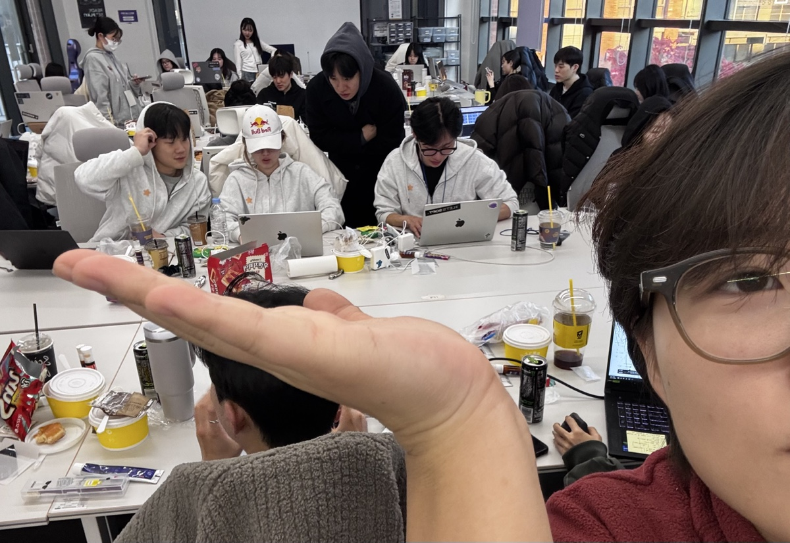

<div align="leading">

# 반하나:  우리 반이 하나 되는 온라인 운동회

<!-- 서비스명 확정 후 위 제목을 변경하고, 필요하면 여기에 로고 또는 배너를 추가해 주세요. -->


### 우리 반에서 시작되는, 새로운 연결

같은 반 친구들이 한 팀이 되어 말 달리기와 소리 줄다리기로 다른 반과 겨루는 온라인 운동회 서비스

**39기 PLAY SOPT · 솝커톤 iOS 1조**
</div>

<br>

## 01 · 서비스 소개

**화합을 주제로, 함께 참여하고 반응하며 반별 교류를 만들어 갑니다.**

같은 반 친구들이 서로를 알아가고 함께할 기회를 만드는 것이 반하나의 목표입니다.
팀원은 게임방에서 함께 준비하고 종목을 고릅니다. 경기에서 각자의 기록을 모아 팀 성적을 겨루고, 설계상 경기 승점은 랭킹에 반영됩니다.

| 대상 | 핵심 경험 | 참여 방식 |
| :---: | :---: | :---: |
| 초·중·고등학생 | 같은 반 친구들과 함께하는 반 대항전 | 말 달리기 · 소리 줄다리기 |

<br>

## 02 · iOS Team

<!-- 각 열이 한 명의 팀원입니다. 사진 → 역할 → 이름/GitHub → 담당 화면·기능 순서로 채워 주세요.
사진 칸 교체 예시: 
리드는 확정 후 해당 역할 칸을 Lead / iOS로 변경합니다.
-->

<table>
  <tr>
    <th align="center" width="25%"><a href="https://github.com/ser0kim"></a></th>
    <th align="center" width="25%"><a href="https://github.com/limtjdghks"></a></th>
    <th align="center" width="25%"><a href="https://github.com/Eda3399"></a></th>
    <th align="center" width="25%"><a href="https://github.com/siiooin"></a></th>
  </tr>
  <tr>
    <td align="center"><b>iOS</b></td>
    <td align="center"><b>iOS</b></td>
    <td align="center"><b>iOS</b></td>
    <td align="center"><b>iOS</b></td>
  </tr>
  <tr>
    <td align="center"><a href="https://github.com/ser0kim"><b>김세령</b></a><br><sub>@ser0kim</sub></td>
    <td align="center"><a href="https://github.com/limtjdghks"><b>임성환</b></a><br><sub>@limtjdghks</sub></td>
    <td align="center"><a href="https://github.com/Eda3399"><b>김보영</b></a><br><sub>@Eda3399</sub></td>
    <td align="center"><a href="https://github.com/siiooin"><b>전시언</b></a><br><sub>@siiooin</sub></td>
  </tr>
  <tr>
    <td align="center"><code>소리 줄다리기</code><br><code>게임 전 과정 구현</code></td>
    <td align="center"><code>말 달리기(연타)</code><br><code>게임 전 과정 구현</code></td>
    <td align="center"><code>랭킹·스플래시 화면 구현</code><br><code>README 작성</code></td>
    <td align="center"><code>앱 진입 흐름</code><br><code>경기 시작 전 화면</code></td>
  </tr>
</table>

<br>

## 03 · 주요 기능 & 기술 스택

### 주요 기능

| 기능 | 화면 설계 |
| --- | --- |
| 앱 진입 · 홈 | 브랜드 인트로 시안 및 우리 반 선수 목록 |
| 매칭 · 게임방 | 상대 탐색 시안, 양 팀 준비 완료 후 종목 선택 |
| 말 달리기 | 연타로 완주하며 팀원들의 완주 시간 합계가 더 짧은 팀이 승리 |
| 소리 줄다리기 | 정해진 시간 동안 마이크로 측정하며 팀원들의 개인 최고 음량 점수 합계가 더 높은 팀이 승리 |
| 랭킹 | 우리 학교 반별 순위와 전국 학교별 순위를 탭으로 제공 |

경기 규칙과 화면별 동선은 [Figma 최종 화면 설계서](https://www.figma.com/design/L0gDQep41Wbg8FmGZJY4ec/?node-id=2417-20)를 참고합니다.

### 시연 영상

<table>
  <tr>
    <th align="center" width="25%">앱 진입 · 홈 · 랭킹</th>
    <th align="center" width="25%">매칭 · 게임방</th>
    <th align="center" width="25%">말 달리기</th>
    <th align="center" width="25%">소리 줄다리기</th>
  </tr>
  <tr>
    <td align="center"><video src="https://github.com/user-attachments/assets/b56c9d44-cc92-44ff-924f-14b905fd9482"></video></td>
    <td align="center"><video src="https://github.com/user-attachments/assets/17c7415f-e984-40ec-a34e-1251dd6e71be"></video></td>
    <td align="center"><video src="https://github.com/user-attachments/assets/80e500c0-d15a-45f9-9e3b-72e042e35496"></video></td>
    <td align="center"><video src="https://github.com/user-attachments/assets/625e1740-aa6a-4f8e-acc6-60263a716b94"></video></td>
  </tr>
  <tr>
    <td align="center">홈에서 전국 학교 순위 목록을 확인하고 학교·반과 선수 목록을 확인 후 게임 입장 합니다</td>
    <td align="center">양 팀 준비 후 종목을 고르고 3·2·1 카운트다운을 거쳐 게임을 시작합니다.</td>
    <td align="center">화면을 연타해 완주하고, 기록과 승패 결과를 확인합니다.</td>
    <td align="center">마이크로 10초간 측정하고 점수를 확인하고 승패 결과를 확인합니다.</td>
  </tr>
</table>

### 기술 스택

| 영역 | 기술 | 적용 범위 |
| --- | --- | --- |
| Language | Swift 5 | 프로젝트 언어 모드 |
| UI | SwiftUI | 화면 구성 기반 |
| State | Observation · MVVM | `@Observable` ViewModel, `@State` 소유 방식이 팀 설계 기준 |
| Network | URLSession · async/await | `BaseService`·`EndPoint` 공통 통신 기반 |
| Resource | Pretendard · Assets | 공통 폰트·이미지 리소스 |

상세 선택 이유와 추천·미정 항목은 [기술 스택 문서](docs/tech-stack.md)를 참고합니다.

<br>

## 04 · Convention & Branch Strategy

### 코드 컨벤션

| 구분 | 규칙 |
| --- | --- |
| 네이밍 | 타입은 `UpperCamelCase`, 함수·변수는 `lowerCamelCase` |
| 식별자 | `userID`, `profileURL`처럼 ID·URL 대문자 유지 |
| 화면 | 부모 화면에만 `View` 접미사 사용 |
| 구조 | `Presentation/<화면>/Model·View·ViewModel` |
| 역할 | View는 UI·이벤트 전달, ViewModel은 상태·처리 담당 |
| 스타일 | 공백 4칸, 줄 길이 90자 권장·최대 99자 |
| 리소스 | 공통 폰트·Assets 우선 재사용 |

[팀 공용 가이드](AGENTS.md) · [Swift 상세 스타일](docs/swift-style.md) · [폴더·리소스 규칙](docs/structure-assets.md)

### 브랜치 전략

**최신 `main` → 이슈별 작업 브랜치 → PR → 리드 승인 → `main` 병합**

- 작업 브랜치는 `태그/#이슈번호` 형식으로 생성합니다.
- 기능 단위로 커밋하고, 팀 PR 템플릿으로 변경 내용과 검증 결과를 공유합니다.
- 병합 전 최신 `main`을 반영하고, 병합이 끝난 작업 브랜치는 삭제합니다.
- PR 생성 시와 병합 전에 팀 카카오톡으로 공유합니다.

```text
브랜치    docs/#17
커밋      [docs] #17 - README 템플릿 작성
PR 제목   [docs/#17] README 템플릿 작성
```

<!-- PR 제목은 이번 작업의 예시이며, 팀의 고정 규칙을 뜻하지 않습니다. -->

자세한 태그와 협업 절차는 [Git 컨벤션](docs/git.md)을 참고합니다.

<br>

## 05 · Before — 해커톤 시작 전, 우리


<br>

## 06 · After — 해커톤이 지나간 자리…


