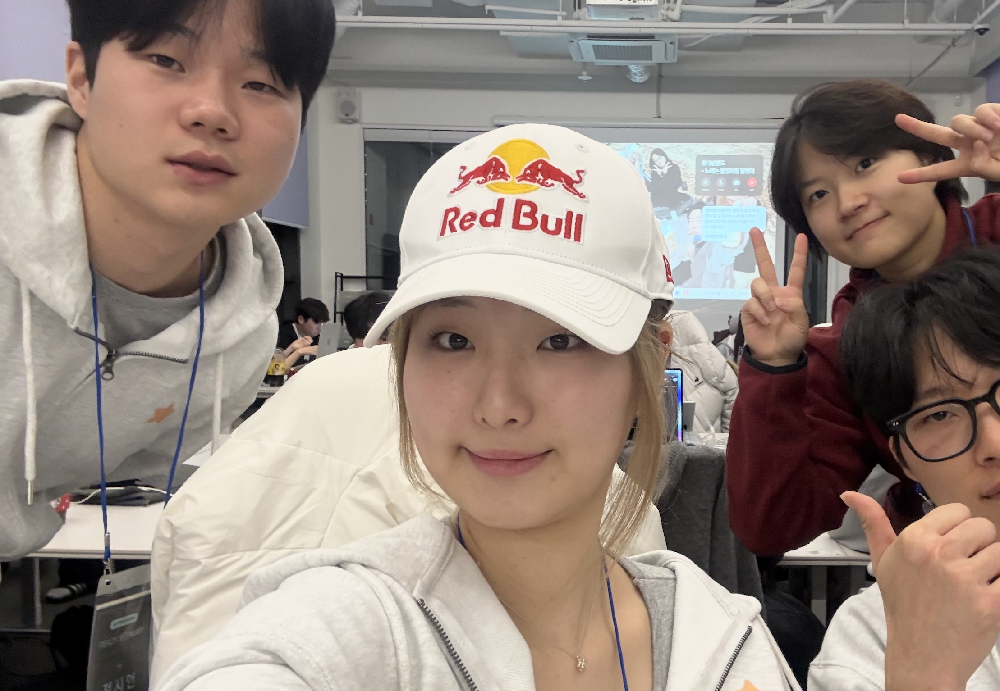

<div align="leading">

# 서비스 이름

<!-- 서비스명 확정 후 위 제목을 변경하고, 필요하면 여기에 로고 또는 배너를 추가해 주세요. -->

### 우리 반에서 시작되는, 새로운 연결

초·중·고등학생이 함께하는 게임으로 반 사이의 연결을 이어가는 iOS 앱

**39기 PLAY SOPT · 솝커톤 iOS 1조**
</div>

<br>

## 01 · 서비스 소개

**화합을 주제로, 함께 참여하고 반응하며 반별 교류를 만들어 갑니다.**

사회성 결여와 끊겨 있는 연결성에 주목했습니다.
문답 형식의 영상 릴레이와 참여 방식이 다른 여러 게임을 통해,
서로를 알아가고 함께할 기회를 만드는 것을 목표로 합니다.

| 대상 | 핵심 경험 | 참여 방식 |
| :---: | :---: | :---: |
| 초·중·고등학생 | 게임을 통한 반별 교류 | 반 전체 등록 정원 + 게임별 참여 정원 |

> 현재 기획 기준입니다. 추가 게임의 종류·규칙과 정원 수치는 미정입니다.

<br>

## 02 · iOS Team

<!-- 각 열이 한 명의 팀원입니다. 사진 → 역할 → 이름/GitHub → 담당 화면·기능 순서로 채워 주세요.
사진 칸 교체 예시: 
리드는 확정 후 해당 역할 칸을 Lead / iOS로 변경합니다.
-->

<table>
  <tr>
    <th align="center" width="25%">📸 사진 추가 예정</th>
    <th align="center" width="25%">📸 사진 추가 예정</th>
    <th align="center" width="25%">📸 사진 추가 예정</th>
    <th align="center" width="25%">📸 사진 추가 예정</th>
  </tr>
  <tr>
    <td align="center"><b>iOS</b></td>
    <td align="center"><b>iOS</b></td>
    <td align="center"><b>iOS</b></td>
    <td align="center"><b>iOS</b></td>
  </tr>
  <tr>
    <td align="center"><a href="https://github.com/ser0kim"><b>김세령</b></a><br><sub>@ser0kim</sub></td>
    <td align="center"><a href="https://github.com/limtjdghks"><b>임성환</b></a><br><sub>@limtjdghks</sub></td>
    <td align="center"><a href="https://github.com/Eda3399"><b>김보영</b></a><br><sub>@Eda3399</sub></td>
    <td align="center"><a href="https://github.com/siiooin"><b>전시언</b></a><br><sub>@siiooin</sub></td>
  </tr>
  <tr>
    <td align="center"><code>담당 화면 입력</code><br><code>담당 기능 입력</code></td>
    <td align="center"><code>담당 화면 입력</code><br><code>담당 기능 입력</code></td>
    <td align="center"><code>담당 화면 입력</code><br><code>담당 기능 입력</code></td>
    <td align="center"><code>담당 화면 입력</code><br><code>담당 기능 입력</code></td>
  </tr>
</table>

<br>

## 03 · 주요 기능 & 기술 스택

### 주요 기능

<!-- 구현 후 각 기능의 상태와 설명을 실제 동작에 맞춰 갱신해 주세요. -->

| 기능 | 내용 | 상태 |
| --- | --- | :---: |
| 온보딩 | 학교·학년·반·번호·이름 입력 및 서버 등록 | 기획 |
| 게임 참여 | 여러 방식의 게임 제공, 반 전체·게임별 정원 적용 | 기획 |
| 주요 게임 | 음성으로 공 굴리기 · 소설 이어 쓰기 릴레이 · 사진 이어 찍기 | 논의 중 |
| 문답 영상 릴레이 | 질문을 매개로 영상을 공유하며 반별 교류 | 기획 |
| 반응 & 순위 | 기존 영상 릴레이에서 일정 기간 반응을 모아 순위 산정 | 기획 |

주요 게임은 논의 중인 후보이며, 구체적인 규칙과 결과 집계 방식은 확정 후 작성합니다.

### 기술 스택

| 영역 | 기술 | 적용 범위 |
| --- | --- | --- |
| Language | Swift 5 | 프로젝트 언어 모드 |
| UI | SwiftUI | 화면 구성 기반 |
| State | Observation · MVVM | `@Observable` ViewModel, `@State` 소유 방식이 팀 설계 기준 |
| Network | URLSession · async/await | `BaseService`·`EndPoint` 공통 통신 기반 |
| Resource | Pretendard · Assets | 공통 폰트·이미지 리소스 |

상세 선택 이유와 추천·미정 항목은 [기술 스택 문서](docs/tech-stack.md)를 참고합니다.

<br>

## 04 · Convention & Branch Strategy

### 코드 컨벤션

| 구분 | 규칙 |
| --- | --- |
| 네이밍 | 타입은 `UpperCamelCase`, 함수·변수는 `lowerCamelCase` |
| 식별자 | `userID`, `profileURL`처럼 ID·URL 대문자 유지 |
| 화면 | 부모 화면에만 `View` 접미사 사용 |
| 구조 | `Presentation/<화면>/Model·View·ViewModel` |
| 역할 | View는 UI·이벤트 전달, ViewModel은 상태·처리 담당 |
| 스타일 | 공백 4칸, 줄 길이 90자 권장·최대 99자 |
| 리소스 | 공통 폰트·Assets 우선 재사용 |

[팀 공용 가이드](AGENTS.md) · [Swift 상세 스타일](docs/swift-style.md) · [폴더·리소스 규칙](docs/structure-assets.md)

### 브랜치 전략

**최신 `main` → 이슈별 작업 브랜치 → PR → 리드 승인 → `main` 병합**

- 작업 브랜치는 `태그/#이슈번호` 형식으로 생성합니다.
- 기능 단위로 커밋하고, 팀 PR 템플릿으로 변경 내용과 검증 결과를 공유합니다.
- 병합 전 최신 `main`을 반영하고, 병합이 끝난 작업 브랜치는 삭제합니다.
- PR 생성 시와 병합 전에 팀 카카오톡으로 공유합니다.

```text
브랜치    docs/#17
커밋      [docs] #17 - README 템플릿 작성
PR 제목   [docs/#17] README 템플릿 작성
```

<!-- PR 제목은 이번 작업의 예시이며, 팀의 고정 규칙을 뜻하지 않습니다. -->

자세한 태그와 협업 절차는 [Git 컨벤션](docs/git.md)을 참고합니다.

<br>

## 05 · Before — 해커톤 시작 전, 우리


